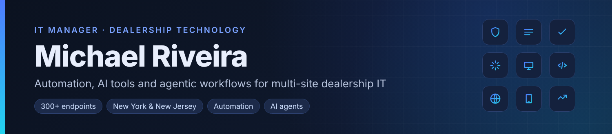

# Hi, I'm Michael Riveira 👋

**IT Manager · Dealership Technology · Automation · AI Agents & Agentic Workflows**

I'm the IT Manager at **Generation Auto Group**, responsible for every part of technology across our dealerships in **New York and New Jersey**: infrastructure, **500+ endpoints**, systems, security and the dealership software stack. I use automation and AI tools to take repetitive work off people's plates and keep a multi-location operation running smoothly.

📍 New York

---

### 🔧 What I work on

- **IT Management:** multi-site dealership IT across NY & NJ, 500+ managed endpoints, provisioning, security and support
- **IT & Automation:** scripting and scheduling routine admin, reporting and data-movement tasks
- **Dealership Tech:** DMS, CRM and inventory data integrations; lead routing; reporting for sales and service
- **AI Tools:** LLM-powered assistants for internal knowledge, document handling and customer communication
- **Agentic Workflows:** multi-step AI agents that use tools, APIs and human approval steps to finish real tasks

### 🧰 Toolbox

| Area | Tools |
|---|---|
| Dealer management systems & data | CDK · Reynolds and Reynolds · Tekion · Authenticom (DMS data integration) |
| Customer engagement | Podium · Numa · MasterMind |
| Endpoint management & security | Atera (RMM & help desk) · NinjaOne (NinjaRMM) · Action1 (patching) · Webroot · Apple Business Manager · SimpleMDM |
| Passwords & remote access | Keeper · KeePass · Splashtop |
| Microsoft 365 & documentation | Office 365 administration · Afi.AI (Microsoft 365 backups) · Confluence |
| Network, domains & phones | UniFi Site Manager · Cloudflare · GoDaddy · MxToolbox · GoTo (phone system) |
| AI & automation | Claude Code · MCP connectors |

### 🚀 Featured projects

| Project | What it does |
|---|---|
| [Dealership IT Dashboard](https://github.com/MikeRiveira/dealership-it-dashboard) · [live demo](https://mikeriveira.github.io/dealership-it-dashboard/) | One screen for multi-store dealership IT: ranked help desk queue, new hire and termination checklists, device health per site, domain security checks, and an AI assistant that briefs you |
| [Dealership IT Security & AI Training](https://github.com/MikeRiveira/dealership-security-ai-training) | Seven animated training videos for every dealership department on phishing, passwords, customer data, ransomware and responsible AI use, with NY, NJ and federal rules built in. Includes the facilitator guide, quiz key and legal references |
| [Domain Security Checker](https://github.com/MikeRiveira/domain-security-checker) | Check MX, SPF, DKIM, DMARC, MTA-STS, BIMI, SSL and domain expiry across every domain you own, with a daily GitHub Actions scan and text, Markdown, JSON or CSV reports |
| [IT Certification Study Guides](https://github.com/MikeRiveira/study-guides) · [Start here: career roadmap](https://mikeriveira.github.io/study-guides/) · [A+](https://mikeriveira.github.io/study-guides/aplus/) · [Network+](https://mikeriveira.github.io/study-guides/netplus/) · [Security+](https://mikeriveira.github.io/study-guides/securityplus/) · [AZ-900](https://mikeriveira.github.io/study-guides/az900/) · [CCNA](https://mikeriveira.github.io/study-guides/ccna/) · [CySA+](https://mikeriveira.github.io/study-guides/cysaplus/) · [Cheat sheets](https://mikeriveira.github.io/study-guides/cheatsheets/) | Free interactive study guides for CompTIA A+, Network+, Security+, CySA+, Microsoft Azure Fundamentals (AZ-900) and Cisco CCNA that run in any browser, plus an IT career roadmap that picks your first cert and shows where each one leads, and printable quick reference cheat sheets (ports, subnetting, commands, acronyms): lessons with interactive diagrams, hands-on simulations (including a simulated Cisco IOS command line and a SOC analyst console), spaced-repetition flashcards, timed practice exams and a level-up system with ranks and badges |
| [Atera Triage MCP](https://github.com/MikeRiveira/atera-triage-mcp) | MCP server that lets AI assistants triage an Atera help desk: ranked tickets with reasons, technician workload, site health and alerts, with personal data redacted. Graded A·A·A on [Glama](https://glama.ai/mcp/servers/MikeRiveira/atera-triage-mcp) |

### 📈 Impact highlights

- Run IT for **6 rooftops and ~240 employees** across New York and New Jersey, covering **500+ endpoints**
- Cut **Microsoft 365 licensing costs by over 60%** across 6 tenants by removing unneeded licenses and moving Outlook-only staff from Business Basic to Kiosk plans
- Locked down **all 6 company domains** against email spoofing with SPF, DKIM and DMARC set to quarantine

### 🤝 Connect

[LinkedIn](https://www.linkedin.com/in/michael-riveira-874a06178/)
